# DB 설계 (2단계 초안)

브라우저 localStorage에 있던 데이터를 Supabase 서버로 옮기기 위한 테이블·권한 설계.
전제는 `결정필요.md` "정한 것"(1·2·4·5·6·7·13번). 미정 항목(3·10·11·12·14·15번)은 **어느 쪽으로 정해도 테이블을 다시 짜지 않도록** 설계하고 `【미정 n】`으로 표시한다.
기준일: 2026-10-03 · 상태: 초안(실행 전)

---

## 1. 요약

- 모든 데이터를 Supabase(Postgres) 한 곳에 두고, 로그인은 **Supabase Auth**(이메일 인증·비밀번호 찾기 기본 제공), 데이터 접근은 **RLS**(행 단위 권한)로 팀·역할별로 서버에서 막는다.
- 선수 연결은 이름이 아니라 **선수 id**. 가입 코드는 무작위·14일 만료·1회용·재발급 시 이전 코드 무효. 선수는 삭제 대신 **보관**.
- 측정 기록은 **입력할 때마다 1행 + 값은 JSON**, 행마다 "입력한 계정·역할·확인 상태"를 담아 3번 결정이 어느 쪽이든 그대로 쓴다.
- 선수끼리 비교되는 점수는 **서버 함수가 계산해 저장**하고, 다른 선수 점수는 공개 범위 설정(10번)을 따르는 함수로만 내준다. 다른 선수의 측정 원자료·신체 점수는 선수 브라우저에 아예 오지 않는다.
- `기능목록.md` "알려진 문제" 중 해결: 기기마다 따로 저장 · 비밀번호 평문 · 로그인 상태 위조 · 로그인 오류로 이메일 가입 여부 노출 · 역할 구분이 화면에서만(역산 문제는 10번과 함께) · 여러 탭 덮어쓰기 · 이름으로 코드·계정 연결 · 이름 수정·삭제 즉시 미반영 · 예시 SBI 값 재충전.

---

## 2. 역할·권한 표

R = 읽기, W = 추가·수정, D = 삭제, — = 불가. 감독은 코치 권한을 모두 가진다. 학부모는 시범 운영 동안 선수와 같다(정책은 분리해 두어 나중에 따로 바꿀 수 있음).

| 데이터 | 관리자 | 감독 | 코치 | 선수 | 학부모 |
|---|---|---|---|---|---|
| 팀(이름·지역·설정) | RWD | R | R | R(이름) | R(이름) |
| 팀 구성원(감독·코치) | RWD | R · 코치 D | R | — | — |
| 감독 가입 코드 | RW(발급·재발급) | — | — | — | — |
| 코치·선수·학부모 가입 코드 | R | RW(발급·재발급) | — | — | — |
| 선수 기본 정보(이름·포지션·등번호·학년) | R | RWD¹ | R | R(팀 선수) | R(팀 선수) |
| 선수 보관(졸업·이적) | R | W | — | — | — |
| 선수-계정 연결(가입 여부·이메일) | R | R · D(연결 해제) | R(가입 여부) | R(본인) | R(본인) |
| 측정 기록 — 본인 것 | R | — | — | R · W² · D(확인 전 본인 입력분) | 선수와 같음 |
| 측정 기록 — 팀 선수 | R | R · W² · D | R · W² · D | — | — |
| 측정 확인(승인·반려) 【미정 3】 | — | W | W | — | — |
| SBI/SMI 측정(이력) | 측정 기록과 같음 | ← | ← | ← | ← |
| 점수 — 본인 | R | R | R | R | R |
| 점수 — 다른 선수 종합·운동능력·실전 【미정 10】 | R | R | R | 설정에 따라 R | 설정에 따라 R |
| 점수 — 다른 선수 신체 | R | R | R | — | — |
| 피드백 | R | RWD | RW · D(본인 작성분) | R(본인 + 팀 전체) | R(본인 + 팀 전체) |
| 주간 훈련 일정 | R | RWD | RWD | R | R |
| 다가오는 일정 | R | RWD | RWD | R | R |
| 경기(날짜·상대·점수) | R | RWD | RWD | R | R |
| 타격·투구 기록 | R | RWD | RWD | R(본인 줄) | R(본인 줄) |
| 라인업(+저장 이력) | R | RW | RW | R(최신) | R(최신) |
| 측정 항목 설정(입력 주체) 【미정 3】 | RW | R | R | R | R |
| 관리자 표시 | SQL 편집기로만 | — | — | — | — |

¹ 삭제는 아무 데서도 참조하지 않는 선수(잘못 등록)만 가능. 시합 기록이 있으면 DB가 삭제를 거부하고 보관만 된다(13번).
² 항목별 입력 주체는 `metric_items.input_by` 설정을 따른다. 지금 동작(선수만 입력)은 모든 항목 `player`로 둔다.

---

## 3. 테이블 (18개)

공통: `id uuid` 기본값 `gen_random_uuid()`, 시각은 `timestamptz`, 모든 테이블 RLS 켬. `team_id`가 있는 자식 테이블은 트리거로 부모(선수·경기)의 팀과 같은지 검사해 **다른 팀 선수 id를 끼워 넣는 것**을 막는다.

### 3-1. 계정·팀

**teams — 팀**
| 컬럼 | 타입 | 설명 |
|---|---|---|
| id | uuid PK | |
| name | text not null | 팀 이름 |
| region | text | 지역 |
| ranking_scope | text not null default `'all'` | 【미정 10】 다른 선수 점수 공개 범위. `all`(지금 동작) / `self_only` / `anonymous`(이름 가림) / `top_n` |
| ranking_top_n | smallint | `top_n`일 때 인원 |
| created_by | uuid → profiles | 만든 관리자 |
| created_at | timestamptz | |

**profiles — 계정 프로필** (`auth.users` 1:1, 가입 시 트리거로 생성)
| 컬럼 | 타입 | 설명 |
|---|---|---|
| id | uuid PK → auth.users on delete cascade | |
| display_name | text not null | 화면 이름(코치 이름 등) |
| email | text | auth.users 이메일 사본(감독 화면 "연결된 이메일" 표시용, 트리거로 동기화) |
| created_at | timestamptz | |

**app_admins — 관리자 표시**
| 컬럼 | 타입 | 설명 |
|---|---|---|
| user_id | uuid PK → profiles | 관리자 계정 |
| created_at | timestamptz | |

쓰기 정책 없음. 관리자는 SQL 편집기로만 넣는다(앱으로 관리자 권한을 얻을 길이 없음).

**team_members — 팀 구성원(감독·코치)**
| 컬럼 | 타입 | 설명 |
|---|---|---|
| team_id | uuid → teams | |
| user_id | uuid → profiles | |
| role | text check (`head_coach`, `coach`) | 감독 / 코치 |
| joined_at | timestamptz | |

키: PK(team_id, user_id). 한 계정이 여러 팀에 속할 수 있는 구조(시범 운영은 1팀).

**players — 선수**
| 컬럼 | 타입 | 설명 |
|---|---|---|
| id | uuid PK | 가입 코드·계정·기록이 모두 이 id로 연결 |
| team_id | uuid → teams | 바꿀 수 없음(이적은 보관 후 새 팀에서 새로 등록) |
| name | text not null | 동명이인 허용(연결이 id라서). 화면의 중복 검사는 그대로 둘 수 있음 |
| position | text check (`투수`,`포수`,`내야수`,`외야수`) | |
| back_number | smallint check 0~99 | |
| grade | smallint check 1~3 | 학년 |
| status | text check (`active`,`archived`) default `active` | 활동 / 보관 |
| archived_reason | text check (`졸업`,`이적`,`기타`) | 보관 사유 |
| archived_at | timestamptz | |
| created_by | uuid → profiles | |
| created_at | timestamptz | |

키: 활동 선수끼리만 등번호 중복 금지 — `unique (team_id, back_number) where status = 'active'`.
삭제: 시합 기록(`batting_lines`·`pitching_lines`)은 `on delete restrict` → 경기에 나온 선수는 삭제 불가, 보관만.

**player_accounts — 선수-계정 연결(본인·학부모)**
| 컬럼 | 타입 | 설명 |
|---|---|---|
| player_id | uuid → players on delete cascade | |
| user_id | uuid → profiles on delete cascade | |
| relation | text check (`self`,`parent`) | 본인 / 학부모 |
| linked_at | timestamptz | |

키: PK(player_id, relation) → **선수당 본인 1·학부모 1**을 DB가 강제. unique(player_id, user_id).
형제 선수의 학부모는 같은 계정을 여러 선수에 연결한다(결정 17 확정). 로그인한 학부모가 두 번째 자녀의 학부모 코드를 입력하면 `redeem_signup_code`가 연결만 추가. 화면은 "자녀 선택".

**signup_codes — 가입 코드**
| 컬럼 | 타입 | 설명 |
|---|---|---|
| id | uuid PK | |
| code | text unique | 무작위 8자, 헷갈리는 글자(0·O·1·I·L) 제외 32자 알파벳 |
| team_id | uuid → teams | |
| role | text check (`head_coach`,`coach`,`player`,`parent`) | 감독 / 코치 / 선수 본인 / 학부모 |
| player_id | uuid → players on delete cascade | `player`·`parent`일 때 필수, 그 외 null (check) |
| issued_by | uuid → profiles | 발급자 |
| issued_at | timestamptz | |
| expires_at | timestamptz default now() + 14일 | |
| used_at · used_by | timestamptz · uuid | 1회용 |
| revoked_at | timestamptz | 재발급하면 이전 코드에 기록 |

키: 살아 있는 선수 코드는 선수·관계당 1개 — `unique (player_id, role) where used_at is null and revoked_at is null`. 코치 코드는 초대 인원만큼 여러 개 가능.
쓰기는 직접 못 하고 함수로만: `issue_signup_code`(재발급 시 이전 코드 revoke, 이미 연결된 관계면 거부), `peek_signup_code`, `redeem_signup_code`(6장).

### 3-2. 측정·점수

**metric_items — 측정 항목 설정** 【미정 3】
| 컬럼 | 타입 | 설명 |
|---|---|---|
| key | text PK | 지금 `types.ts` 필드 이름 그대로(`height`, `dash60`, `squatReps` …) |
| grp | text check (`body`,`athletic`,`practical`,`sbi`) | 분야 |
| label · unit | text | 화면 이름 · 단위 |
| value_type | text check (`number`,`text`,`choice`) | 부상 이력은 text, 선수 유형은 choice |
| min_value · max_value | numeric | 입력 범위 검사 |
| input_by | text check (`player`,`coach`,`both`) | **누가 입력하나** — `측정항목.md` 분류 결과를 그대로 넣는 곳 |
| needs_confirm | boolean default false | 선수 입력값을 코치 확인 후 반영할지 |
| sort · active | smallint · boolean | 순서 · 사용 여부(삭제 대신 끔) |

처음 값: 34개 모두 `input_by='player'`, `needs_confirm=false` = 지금 동작. 3번이 정해지면 **이 표의 값만 바꾼다**(테이블 변경 없음). 새 항목도 행 추가로 끝.

**measurements — 측정 기록(신체·운동능력·실전·SBI/SMI 공통)**
| 컬럼 | 타입 | 설명 |
|---|---|---|
| id | uuid PK | |
| player_id | uuid → players on delete cascade | |
| team_id | uuid → teams | 트리거가 선수의 팀으로 채움(RLS용) |
| measured_on | date not null | 측정일(지금은 항상 오늘, 코치 단체 측정 날짜도 가능) |
| source | text check (`input`,`sbi`,`register`) | 데이터 입력 화면 / SBI 화면 / 선수 등록 |
| data | jsonb not null | `{"height":172.3,"dash60":7.4,"kind":"투수",…}` — 이번에 입력한 항목만(`values`는 SQL 예약어라 `data`) |
| entered_by | uuid → profiles | **입력한 계정**(트리거가 로그인 계정으로 덮어씀) |
| entered_role | text check (`head_coach`,`coach`,`player`,`parent`) | **입력한 역할**(트리거가 계산) |
| status | text check (`pending`,`confirmed`,`rejected`) | **확인 상태**(트리거가 `needs_confirm`으로 결정. 선수가 직접 `confirmed`를 넣을 수 없음) |
| reviewed_by · reviewed_at | uuid · timestamptz | 확인·반려한 코치 |
| created_at | timestamptz | |

검사 트리거: `data`의 키가 `metric_items`에 있고 `active`인지, 입력 역할이 `input_by`에 맞는지, 숫자가 범위 안인지. 맞지 않으면 저장 거부.
SBI/SMI는 같은 테이블에 `source='sbi'`로 **저장할 때마다 1행** → 이력이 남는다(지금은 덮어씀). 코치 SBI 화면의 "최신"은 가장 최근 `sbi` 행.

**열로 펼칠지 JSON일지 — JSON으로 결정**
| 기준 | 열 34개로 펼침 | JSON 1칸 (채택) |
|---|---|---|
| 3번: 항목마다 입력 주체가 다를 때 | 한 행에 선수 값·코치 값이 섞여 "누가 입력했나"를 행 하나로 못 담음 | 입력 1번 = 1행 = 입력자 1명. 이번에 넣은 항목만 담음 |
| 항목 추가·삭제(`측정항목.md` 메모) | 매번 테이블 변경 | `metric_items` 행 추가·끄기 |
| 값 검사 | 열 타입·check | 트리거가 `metric_items` 범위로 검사 |
| 지금 코드와의 거리 | 중첩 Snapshot ↔ 열 변환 필요 | 키 = 지금 필드 이름, 변환이 단순 |
| 단점 | — | SQL로 항목별 통계 내기가 덜 편함(지금 앱에는 그런 기능 없음) |

점수용 "스냅숏"은 앱·서버 함수가 확인된 행을 날짜순으로 쌓아 **항목별 마지막 값**으로 만든다. 데이터 입력 화면은 지금처럼 25개 항목을 한 번에 저장하므로 성장 그래프의 점 하나 = 행 하나로 지금과 같다.
【미정 11】 선수 등록 때는 실제 입력한 4개(나이·키·몸무게·선수 유형)만 `source='register'`로 저장하고, 빈 항목의 기본값은 **저장하지 않고 계산할 때 채운 뒤 `uses_defaults` 표시** → 숨길지 그대로 쓸지는 계산·화면에서 결정.
【미정 12】 SBI 계산에 쓸 신장·구속은 지금처럼 측정 기록 최신값을 쓰거나, SBI 행에 `sbiHeight`·`sbiVelo` 키를 추가해 따로 저장 — 둘 다 테이블 변경 없음.

**player_scores — 서버가 계산한 최신 점수**
| 컬럼 | 타입 | 설명 |
|---|---|---|
| player_id | uuid PK → players on delete cascade | |
| team_id | uuid → teams | |
| total · body · athletic · practical | smallint | 종합·분야 점수 |
| total_grade | char(1) | S~D |
| injury_level | text | 낮음/보통/높음(코치 목록 요약용) |
| sbi · smi · final_r | numeric(5,1) | SBI 측정이 없으면 null |
| uses_defaults | boolean | 기본값으로 채운 항목이 있음 【미정 11】 |
| basis_at | timestamptz | 계산에 쓴 마지막 확인 기록 시각(오래됐는지 판단) |
| calc_version | text | 계산 기준 버전(8번으로 기준이 바뀌면 일괄 재계산) |
| computed_at | timestamptz | |

쓰기 정책 없음 — **서버 함수(서비스 키)만** 쓴다. 브라우저가 점수를 위조할 수 없음.

### 3-3. 팀 운영

**feedbacks — 피드백**
| 컬럼 | 타입 | 설명 |
|---|---|---|
| id | uuid PK | |
| team_id | uuid → teams | |
| player_id | uuid → players on delete cascade, null 허용 | null = 팀 전체 |
| author_id | uuid → profiles | |
| author_name | text | 작성 당시 이름(선수가 코치 프로필을 읽지 않아도 표시) |
| category | text | 훈련·투구·타격·팀 전체 등 |
| content | text not null | |
| written_on | date default 오늘 | |
| created_at | timestamptz | |

**training_slots — 주간 훈련 일정**
| 컬럼 | 타입 | 설명 |
|---|---|---|
| id | uuid PK | |
| team_id | uuid → teams | |
| day | text check (`월`~`일`) | |
| position | text check (`전체`,`투수`,`포수`,`내야수`,`외야수`) | |
| time_text | text | 지금처럼 자유 입력 |
| content | text | |
| created_by · created_at | | |

**events — 다가오는 일정**
| 컬럼 | 타입 | 설명 |
|---|---|---|
| id | uuid PK | |
| team_id | uuid → teams | |
| event_date | date | |
| type | text check (`훈련`,`시합`) | |
| title · place | text | |
| created_by · created_at | | |

**games — 경기**
| 컬럼 | 타입 | 설명 |
|---|---|---|
| id | uuid PK | |
| team_id | uuid → teams | |
| game_date | date | |
| opponent | text | |
| score_for · score_against | smallint ≥ 0 | |
| result | text generated (점수 비교로 승·패·무) | 지금처럼 자동 판정, 서버가 계산 |
| created_by · created_at | | |

**batting_lines — 타격 기록**
| 컬럼 | 타입 | 설명 |
|---|---|---|
| game_id | uuid → games on delete cascade | |
| player_id | uuid → players on delete **restrict** | 보관 선수 기록 유지 |
| ab · hits · hr · rbi · sb | smallint ≥ 0 | check: hits ≤ ab, hr ≤ hits |

키: PK(game_id, player_id) → 같은 선수 중복 금지(지금 화면 검사를 DB도 강제).

**pitching_lines — 투구 기록**
| 컬럼 | 타입 | 설명 |
|---|---|---|
| game_id | uuid → games on delete cascade | |
| player_id | uuid → players on delete restrict | |
| outs | smallint ≥ 0 | 【미정 15】 잡은 아웃 수(5⅓이닝 = 16). 이닝 표시는 화면에서 변환 |
| er · so · bb | smallint ≥ 0 | |

키: PK(game_id, player_id).

**lineups — 라인업 저장 이력**
| 컬럼 | 타입 | 설명 |
|---|---|---|
| id | uuid PK | |
| team_id | uuid → teams | |
| saved_by | uuid → profiles | |
| saved_at | timestamptz | 팀의 최신 행 = 현재 라인업 |

**lineup_slots — 라인업 자리**
| 컬럼 | 타입 | 설명 |
|---|---|---|
| lineup_id | uuid → lineups on delete cascade | |
| slot | text check (`선발투수`,`1번`~`9번`) | |
| player_id | uuid → players on delete cascade | |

키: PK(lineup_id, slot), unique(lineup_id, player_id) → 한 선수 한 자리. 선발투수는 `position='투수'`인지 트리거로 검사.
저장할 때마다 새 `lineups` 행 → 이력이 남는다(지금은 덮어씀). 저장 전 "추천 라인업"은 저장하지 않고 화면에서 계산(7장).

---

## 4. 관계도

```mermaid
erDiagram
    AUTH_USERS ||--|| PROFILES : "1:1"
    PROFILES ||--o| APP_ADMINS : "관리자 표시"
    TEAMS ||--o{ TEAM_MEMBERS : "감독·코치"
    PROFILES ||--o{ TEAM_MEMBERS : "소속"
    TEAMS ||--o{ PLAYERS : "선수"
    PLAYERS ||--o{ PLAYER_ACCOUNTS : "본인·학부모"
    PROFILES ||--o{ PLAYER_ACCOUNTS : "계정"
    TEAMS ||--o{ SIGNUP_CODES : "가입 코드"
    PLAYERS |o--o{ SIGNUP_CODES : "선수 코드"
    METRIC_ITEMS ||..o{ MEASUREMENTS : "data 키 검사"
    PLAYERS ||--o{ MEASUREMENTS : "측정 기록"
    PROFILES ||--o{ MEASUREMENTS : "입력자"
    PLAYERS ||--o| PLAYER_SCORES : "최신 점수"
    TEAMS ||--o{ FEEDBACKS : "피드백"
    PLAYERS |o--o{ FEEDBACKS : "개인 피드백"
    TEAMS ||--o{ TRAINING_SLOTS : "주간 훈련"
    TEAMS ||--o{ EVENTS : "다가오는 일정"
    TEAMS ||--o{ GAMES : "경기"
    GAMES ||--o{ BATTING_LINES : "타격"
    GAMES ||--o{ PITCHING_LINES : "투구"
    PLAYERS ||--o{ BATTING_LINES : "restrict"
    PLAYERS ||--o{ PITCHING_LINES : "restrict"
    TEAMS ||--o{ LINEUPS : "저장 이력"
    LINEUPS ||--|{ LINEUP_SLOTS : "자리"
    PLAYERS ||--o{ LINEUP_SLOTS : "배치"

    TEAMS {
        uuid id PK
        text name
        text ranking_scope "미정 10"
    }
    PROFILES {
        uuid id PK
        text display_name
        text email
    }
    TEAM_MEMBERS {
        uuid team_id PK
        uuid user_id PK
        text role "head_coach|coach"
    }
    PLAYERS {
        uuid id PK
        uuid team_id FK
        text name
        text status "active|archived"
    }
    PLAYER_ACCOUNTS {
        uuid player_id PK
        text relation PK "self|parent"
        uuid user_id FK
    }
    SIGNUP_CODES {
        uuid id PK
        text code UK
        text role
        uuid player_id FK
        timestamptz expires_at
    }
    METRIC_ITEMS {
        text key PK
        text input_by "미정 3"
        boolean needs_confirm
    }
    MEASUREMENTS {
        uuid id PK
        uuid player_id FK
        jsonb data
        uuid entered_by FK
        text entered_role
        text status "pending|confirmed|rejected"
    }
    PLAYER_SCORES {
        uuid player_id PK
        smallint total
        smallint body
    }
    GAMES {
        uuid id PK
        uuid team_id FK
        text result
    }
    LINEUPS {
        uuid id PK
        uuid team_id FK
        timestamptz saved_at
    }
    LINEUP_SLOTS {
        uuid lineup_id PK
        text slot PK
        uuid player_id FK
    }
```

---

## 5. RLS 정책 개요

### 5-1. 판단 함수 (모두 `security definer`, `stable`, `search_path` 고정)
| 함수 | 뜻 |
|---|---|
| `is_admin()` | `app_admins`에 `auth.uid()`가 있음 |
| `team_role(t)` | 그 팀에서 내 역할 `head_coach` / `coach` / null |
| `is_staff(t)` | 감독 또는 코치 |
| `is_head(t)` | 감독 |
| `my_players()` | 내 계정에 연결된 선수 id 목록(본인·학부모 모두) |
| `my_relation(p)` | 그 선수와 내 관계 `self` / `parent` — 학부모 권한을 나중에 따로 줄 때 이 함수만 정책에 추가 |
| `is_member(t)` | 직원이거나 그 팀 선수에 연결된 계정 |

정책 안에서는 sportir처럼 `(select is_staff(team_id))` 형태로 감싸 행마다 다시 계산하지 않게 한다.

### 5-2. 팀 경계 강제
- 모든 정책이 행의 `team_id`(자식 테이블은 부모 경기·라인업의 팀)로 판단한다. 다른 팀 행은 읽기·쓰기 모두 0건.
- 참조 검사 트리거 `ensure_same_team`: 피드백·측정·타격·투구·라인업 자리의 `player_id`가 행의 팀 선수인지 확인. 코치가 다른 팀 선수 id를 넣는 것을 막음.
- `players.team_id`, `measurements.entered_by/entered_role/status`는 트리거가 덮어쓰거나 변경을 거부(클라이언트 값 무시).
- 계정이 팀에서 빠지거나 연결이 해제되면 **다음 요청부터** 바로 아무것도 못 읽는다(토큰이 살아 있어도 정책이 매번 구성원 여부를 확인).
- `anon`(로그인 전)은 모든 테이블 0건. 로그인 전 쓰는 것은 `peek_signup_code` 함수 하나.

### 5-3. 테이블별
| 테이블 | SELECT | INSERT | UPDATE | DELETE |
|---|---|---|---|---|
| teams | 구성원·관리자 | 관리자 | 관리자 | 관리자 |
| profiles | 본인 · 관리자 | 트리거(가입 시) | 본인(display_name만) | — (auth 계정 삭제 시 함께) |
| app_admins | 본인 · 관리자 | — | — | — |
| team_members | 같은 팀 직원 · 관리자 | 함수(redeem) | — | 감독(코치만) · 관리자 |
| players | 구성원 · 관리자 | 감독 | 감독 | 감독(참조 없을 때만) |
| player_accounts | 직원 · 연결된 본인 · 관리자 | 함수(redeem) | — | 감독(연결 해제) |
| signup_codes | 감독(자기 팀 코치·선수 코드) · 관리자 | 함수(issue) | 함수(issue·redeem) | — |
| metric_items | 로그인 사용자 | 관리자 | 관리자 | — |
| measurements | 직원 · 연결된 선수의 행 · 관리자 | 직원(팀 선수) · 연결 계정(내 선수, 활동 중) — 항목 검사는 트리거 | 함수(review: 직원) | 직원 · 입력한 본인(`pending`일 때만) |
| player_scores | 직원 · 본인 행 · 관리자 | 서버 함수만 | 서버 함수만 | — |
| feedbacks | 직원 · 선수는 `player_id in my_players() or player_id is null` | 직원 | 작성자 | 감독 · 작성자 |
| training_slots · events · games | 구성원 · 관리자 | 직원 | 직원 | 직원 |
| batting_lines · pitching_lines | 직원 · 선수는 본인 줄만 | 직원 | 직원 | 직원 |
| lineups · lineup_slots | 직원 · 선수는 팀 최신 1건 | 직원 | — (새 행으로 저장) | — |

【확정 10-03, 결정 18】 보관된 선수의 본인 계정은 **로그인 불가**. 학부모 계정은 연결된 자녀가 모두 보관이면 로그인 불가, 활동 중인 자녀가 있으면 그 자녀만 보인다. → `my_players()`는 활동(`active`) 선수만 반환하고, 연결된 활동 선수가 없는 선수·학부모 계정은 앱 진입 시 차단.
【확정 10-03, 결정 19】 관리자는 모든 팀을 **읽기만** 가능, 팀 운영 데이터는 쓰지 않음.

### 5-4. "화면에서만 숨기던 것"을 서버에서 막는 방법
| 지금 화면에서만 숨김 | 서버에서 |
|---|---|
| 다른 선수의 측정 원자료(키·몸무게·부상 이력 등) | `measurements` SELECT가 내 선수 행만 → 브라우저에 오지 않음 |
| 다른 선수의 신체 점수 | 선수에게는 `player_scores` 본인 행만 열림. 순위는 `team_ranking()` 함수가 내주며 **신체 점수 칸이 없음** |
| 종합·운동능력·실전 점수 공개 【미정 10】 | `team_ranking()`이 `teams.ranking_scope`에 따라 이름·점수·인원을 잘라서 반환. 막을 때는 설정값만 바꿈 |
| 종합 점수로 신체 점수 역산 | 종합·운동능력·실전을 모두 보여주면 역산됨(종합 = 신체×0.35+운동×0.30+실전×0.35). 10번 결정 때 세 값 중 무엇을 내줄지 `team_ranking()` 반환 칸으로 정함 |
| 코치 화면 주소(`/c/*`) 접근 | 화면 경로와 무관하게 데이터 요청 자체를 RLS가 거부 |
| 가입 코드 목록(로그인 화면에 데모 코드 공개) | 선수·코치는 코드 테이블을 못 읽음. 로그인 전은 `peek_signup_code`로 입력한 코드 1개만 확인 |
| 다른 계정의 이메일·비밀번호 | 비밀번호는 Supabase Auth가 해시로만 보관. 이메일은 본인과 감독(선수 연결 확인용)만 |
| 확인 전 측정값 【미정 3】 | `pending` 행은 본인·직원만 보이고 `player_scores` 계산에서 제외 |

점수 계산 위치는 7장.

---

## 6. 인증 방식 비교와 추천

| 기준 | (A) Supabase Auth | (B) sportir식 자체 세션 토큰 |
|---|---|---|
| 이메일 인증(6번) | 기본 제공(가입 확인 메일) | 메일 발송·인증 토큰·만료를 직접 구현 |
| 비밀번호 찾기(6번) | 기본 제공(재설정 메일) | 직접 구현 |
| 비밀번호 보관 | 해시, 우리 테이블에 없음 | bcrypt 해시를 우리 테이블에 보관(sportir 방식) |
| 세션 | 서명된 JWT + 자동 갱신 | `app_sessions` 토큰, 만료·갱신 직접 |
| RLS 연결 | `auth.uid()` 바로 사용 | `x-…-session` 헤더 → 판단 함수 |
| 로그인 시도 제한 | 인증 엔드포인트에 기본 제한 | `app_login_attempts` 직접(sportir에 있음) |
| 로그인 오류 문구 | 이메일·비번 구분 없는 한 문구 → 가입 여부 노출 해결 | 직접 |
| 가입 코드 | 별도 함수 필요(아래) | 별도 함수 필요 |
| 맞는 경우 | 이메일 계정 | 이메일 없이 코드·아이디로 로그인(sportir 선수 코드 로그인) |

**추천: (A) Supabase Auth.** 이번 결정이 "이메일 인증 + 이메일 비밀번호 찾기"라서 (B)로 가면 그 두 기능과 메일 발송을 전부 새로 만들어야 한다. sportir가 (B)를 쓴 이유는 이메일 없는 코드 로그인이었고, SPTR에는 그 조건이 없다.

**가입 흐름(A 기준)**
1. 가입 코드 입력 → `peek_signup_code(code)`: 유효하면 "성남중학교 야구부 · 김하준 · 학부모"처럼 팀·역할·선수 이름만 반환. 코드는 32자 알파벳 8자리(약 1조 가지)라 무작위 대입이 비현실적 → sportir식 시도 제한 테이블은 두지 않음(필요해지면 추가).
2. 이메일·비밀번호·이름 → `auth.signUp` (코드는 `user_metadata`에 함께 보관).
3. 메일 링크 클릭 → 이메일 확인·로그인.
4. 로그인 후 팀·선수 연결이 없으면 `redeem_signup_code(code)`: 만료·사용·폐기 확인 후 `team_members` 또는 `player_accounts` 생성, 코드 사용 처리. 그사이 코드가 만료됐으면 "코드 재발급 요청" 화면에서 새 코드만 입력.
- 코드 없이 가입한 계정은 어떤 팀에도 속하지 않아 아무 데이터도 못 읽는다. 원하면 Supabase "가입 전 훅"으로 코드 없는 가입 자체를 막을 수 있음(시범 운영에는 불필요).
- 관리자는 코드 없이 가입한 뒤 SQL 편집기로 `app_admins`에 넣는다.

**HashRouter 주의:** Supabase 기본 메일 링크는 토큰을 주소의 `#` 뒤에 붙여 HashRouter(`#/…`)와 부딪친다. 메일 문구 템플릿을 `{{ .TokenHash }}`를 **쿼리**(`/?token_hash=…&type=…`)로 넘기게 바꾸고 앱이 `verifyOtp`로 처리한다. 다른 기기에서 메일을 열어도 동작한다. 클라이언트는 `detectSessionInUrl: false`.

**sportir에서 재사용할 것**
| 무엇 | sportir 위치 | SPTR에서 |
|---|---|---|
| 마이그레이션 파일 규칙(날짜 이름, 한글 주석, 되돌리기 SQL 별도 폴더) | `supabase/migrations/`, `supabase/rollback/` | 같은 구조로 `supabase/` 새로 만듦 |
| 적용 방식: SQL 편집기에 `monaco…setValue`로 넣고 실행, 적용 여부는 REST로 실제 효과 확인 | 메모(마이그레이션 실행 방법) | 그대로 |
| 롤백 DO 블록 점검: 시험 계정을 만들고 세션을 흉내 낸 뒤 `raise exception`으로 결과만 보고 전부 되돌림 | 메모(RLS 구조) | 헤더 대신 `set local role authenticated` + `request.jwt.claims`의 `sub`로 흉내 |
| 정책 안 판단 함수를 `(select …)`로 감싸기, `security definer` + `search_path` 고정 | `20260912030000_rls_policies.sql` | 그대로 |
| 무작위 코드 생성(32자 알파벳, `gen_random_bytes`), 재발급 시 이전 코드 무효 | `20260914000000_login_codes_hardening.sql` | `issue_signup_code`에 같은 방식 |
| 컬럼 단위 권한 회수(`revoke select` 후 필요한 칸만 `grant`) | 같은 RLS 파일 | 필요 시 |
| 요청 시간 제한을 넣은 Supabase 클라이언트 `fetch` | `src/lib/supabase.js` | 세션 헤더 부분은 빼고 시간 제한만 |
| 예시 데이터 넣기·지우기 SQL(날짜를 실행일 기준으로) | `supabase/seed/demo_center_seed.sql`, `demo_center_reset_data.sql` | 예시 팀 seed·reset(8장) |

재사용하지 않는 것: `app_sessions`·`x-sportir-session` 헤더·`app_login_*` 함수(인증은 Supabase Auth가 대신함).
**sportir 프로젝트에 테이블을 같이 넣지 않는다.** 운영 중인 DB이고, sportir RLS 마이그레이션은 `public`의 정책을 일괄 삭제하는 방식이라 같은 곳에 있으면 SPTR 정책까지 지워질 수 있다.

---

## 7. 점수 계산 위치

| 방식 | 장점 | 단점 |
|---|---|---|
| 지금처럼 브라우저에서 전부 | 코드 그대로 | 순위·추천 라인업을 위해 다른 선수 원자료가 브라우저에 와야 함 → 신체 비공개 불가 |
| 브라우저가 계산해 점수 저장 | 간단 | 선수가 점수를 위조할 수 있음 |
| DB 함수(SQL)로 다시 작성 | 자동·확실 | 계산식이 TS·SQL 두 벌 → 8번으로 기준이 바뀔 때마다 두 곳 수정(이미 있는 "중복 구현" 문제 악화) |
| **서버 함수(TS)가 같은 `gpe.ts`·`sbi.ts`로 계산해 저장** | 계산식 한 벌, 위조 불가, 원자료 비공개 | 서버 함수 1개 추가 |

**추천: 나눠서 계산**
- **브라우저**: 볼 권한이 있는 원자료로 만드는 상세 해설 — 세부 지표·코멘트·훈련 우선순위·부상 리스크 요인·성장방향 문장·성장 그래프. 선수는 자기 기록, 코치는 팀 기록으로 지금 코드 그대로.
- **서버**: 선수끼리 비교되는 숫자(종합·분야 점수·등급·SBI·SMI·최종 R) → `player_scores`. 순위표·코치 목록·추천 라인업은 이 표를 쓴다.
- 서버 함수 위치: **Vercel 함수**(`api/scores.ts`) 추천 — 같은 저장소의 `src/lib/gpe.ts`·`sbi.ts`를 그대로 불러 쓰고, 배포도 지금의 `npx vercel deploy --prod` 하나로 끝남. Supabase Edge Function은 별도 배포 도구·코드 복사가 필요.
  - 호출: 측정 저장·확인 직후 브라우저가 호출. 함수는 로그인 토큰으로 사용자를 확인하고 **DB의 확인된 기록만** 다시 읽어 계산(브라우저가 보낸 값은 안 믿음).
  - 놓친 경우: `basis_at`이 마지막 확인 기록보다 오래되면 화면이 다시 호출.
  - 기준 변경(8번): `calc_version`을 올리고 관리자가 전체 재계산 호출.
  - 서비스 키는 Vercel 환경 변수(이름에 `VITE_`를 붙이지 않음 — 붙이면 브라우저 코드에 들어감).
- 순위 공개(10번): 선수 화면은 `team_ranking()`만 쓴다. 지금 동작은 `ranking_scope='all'`(이름 + 종합·운동능력·실전). 막을 때 설정값만 바꾸면 되고 화면 코드는 받은 칸만 그린다.
- 추천 라인업(14번 미정): 선수 화면은 저장된 라인업을 보여주고, 없으면 `team_ranking()` 결과(포지션·종합)로 지금 `lineup.ts` 규칙대로 화면에서 계산. 공개 범위가 좁아 종합 점수를 못 받으면 추천은 표시하지 않음 → "저장한 라인업만 공개"와 같은 결과. `lineup.ts`는 Player 대신 `{id, position, total}`을 받게 바꾼다.
- 전제: `pages/Sbi.tsx`에 따로 있는 SBI 계산 사본은 서버가 쓰는 `lib/sbi.ts`와 결과가 같아야 한다. 지금은 같은 공식이지만, 8번 전에 계산기를 `lib/sbi.ts`로 합치는 것이 안전(알려진 문제 "같은 계산이 여러 곳").

---

## 8. 예시 데이터와 전환

**예시 팀 넣기**
- `scripts/`의 일회용 스크립트가 지금 `buildSeed()`를 돌려 `supabase/seed/demo_team_seed.sql`을 만든다 → 숫자가 지금 데모와 같음. 이후 `seed.ts`는 앱 번들에서 빠진다.
- 넣는 것: 팀 "성남중학교 야구부", 선수 12명, 선수별 측정 5행(`source='input'`, `status='confirmed'`, 입력자 = 관리자), SBI 1행씩(측정일 채움), 피드백 5, 주간 훈련 8, 경기 3(투구 `outs` = 이닝×3), 다가오는 일정 3(**실행일 기준 미래 날짜**로 — 지금은 지난 7월 날짜).
- 계정은 SQL로 만들지 않는다(비밀번호를 다루지 않기 위해). 관리자가 앱에서 감독 코드 발급 → 태규님 본인 이메일(+별칭 주소)로 감독·선수·학부모 시험 가입.
- `supabase/seed/demo_team_reset.sql`: 예시 팀의 기록만 지우고 다시 넣기(sportir `demo_center_reset_data.sql` 방식, 모든 삭제를 예시 팀 id로 한정). 앱 안 "데모 데이터 초기화"를 대신함.

**localStorage 데모 기능 정리**
| 지금 | 처리 |
|---|---|
| `sptr-db-v2`(전체 DB), `sptr-session-v1`(로그인 id) | 새 버전 첫 실행 때 키 삭제. 데이터 이관 없음(모두 예시 데이터라는 전제 — 10장 확인) |
| `store.tsx`의 `loadDB`·SBI 시드 보강 | 삭제. 화면별 Supabase 조회로 교체 |
| 로그인 화면 데모 계정 칩·데모 가입 코드 칩 | 삭제 |
| 데모 데이터 초기화 버튼 | 삭제(reset SQL로 대체) |
| 휴대폰 본인인증 가짜 버튼 | 삭제(6번: 이메일 인증) |
| `nextPlayerCode`(순번 코드) | 삭제(`issue_signup_code`) |
| `removePlayer`(연쇄 삭제) | 보관 처리 + 참조 없을 때만 삭제 |

---

## 9. 구현 순서

각 단위는 따로 배포 가능하게 나눈다. 데이터 이동(4)까지는 운영 주소에 지금 앱을 그대로 두고 미리보기 배포로 확인한다.

| # | 단위 | 끝났을 때 확인 |
|---|---|---|
| 1 | Supabase 프로젝트 준비: 프로젝트·SMTP·메일 템플릿(쿼리 방식)·리다이렉트 주소, 앱에 `@supabase/supabase-js`와 환경 변수(`VITE_SUPABASE_URL`·`ANON_KEY`) | 앱 빌드 성공, 연결만 하고 화면 동작은 그대로 |
| 2 | 마이그레이션 ①: 테이블 18개·키·제약·트리거(팀 일치·측정 값 검사·결과 자동 판정) + `metric_items` 34행 | SQL 편집기 적용 후 REST로 테이블 확인, 잘못된 값(다른 팀 선수, 범위 밖 값, 중복 등번호) 넣기가 거부되는지 |
| 3 | 마이그레이션 ②: 판단 함수·RLS 정책·가입 코드 함수 3개·`team_ranking()` + 되돌리기 SQL | DO 블록으로 역할 5개를 흉내 내 5장 표대로 읽기·쓰기 결과 확인(전부 롤백) |
| 4 | 예시 팀 seed SQL 생성·적용 | 팀·선수 12·측정 60행·SBI 12행·경기 3 수, 몇 선수의 점수가 지금 데모와 같은지 |
| 5 | 로그인·가입·이메일 인증·비밀번호 찾기 화면(Supabase Auth), 관리자 표시 | 실제 메일로 가입→인증→로그인→로그아웃→비번 재설정, 틀린 비번 문구가 하나 |
| 6 | 가입 코드: 관리자 팀 만들기·감독 코드, 감독 코치 코드, 선수 등록 시 본인·학부모 코드 2개·재발급 | 다른 기기에서 코드로 가입, 만료·재사용·재발급 전 코드가 거부되는지, 같은 관계 두 번째 연결 거부 |
| 7 | 읽기 전환: 모든 화면이 Supabase에서 읽음(`store.tsx` 대체) | 선수·코치 각 화면이 4의 데이터로 지금과 같은 값 표시, 두 기기에서 같은 데이터 |
| 8 | 쓰기 전환: 측정 저장·SBI 저장(이력)·선수 등록/수정/보관·피드백·훈련 일정·경기 등록/삭제·라인업 저장(이력) | 한 기기에서 쓰고 다른 기기에서 보임, 두 탭 동시 저장 시 서로 지우지 않음, 경기에 나온 선수 삭제 거부·보관 동작 |
| 9 | 점수 서버 함수(`api/scores.ts`)·`player_scores`·순위·추천 라인업 전환 | 선수 토큰으로 REST 조회 시 다른 선수 측정·신체 점수가 0건, 순위 숫자가 7과 같음, 측정 저장 후 점수 갱신 |
| 10 | 데모 기능·localStorage 제거(8장 표) | 로그인 화면에 데모 표시 없음, 브라우저 저장소에 `sptr-db-v2` 없음 |
| 11 | 역할별 REST 점검(sportir 방식): 역할 5개 토큰으로 금지된 읽기·쓰기 시도 | 5장 표와 전부 일치 |
| 12 | 문서: `기능목록.md`(저장 위치 "이 브라우저" → "서버", 알려진 문제 정리), `변경기록.md` | 1장의 해결 목록이 실제로 지워짐 |

3번(입력 주체)이 정해지면: `metric_items` 값 변경 + 확인 대기·승인 화면(3단계) — 테이블 변경 없음.

---

## 10. 제품 주인에게 확인할 것 (실행 전)

| # | 확인할 것 | 왜 |
|---|---|---|
| 1 | ~~Supabase 프로젝트~~ **확정(결정 20)**: 새 프로젝트, 태규님 유료 구독 중 | 추가 비용만 생성 시 확인 |
| 2 | ~~무료 요금제 일시 정지~~ **해당 없음**(유료 구독) | |
| 3 | **이메일 발송 방식** | Supabase 기본 메일은 발송 한도가 매우 낮고 조직 구성원 주소로만 보내질 수 있음(확인 필요) → 실제 가입에는 외부 메일 발송 서비스(SMTP) 연결이 필요할 가능성이 큼. 보내는 주소·이름, 도메인 보유 여부 |
| 4 | 메일 문구(가입 확인·비밀번호 재설정)와 링크 주소 | 한국어 문구, 운영 주소 `sptr-one.vercel.app` 기준 |
| 5 | 관리자로 지정할 계정 이메일 | `app_admins`에 넣을 계정 |
| 6 | 비밀값 입력 | Supabase 서비스 키를 Vercel 환경 변수에, SMTP 비밀번호를 Supabase에 — 태규님이 직접 붙여넣기 |
| 7 | 15번(이닝 표기) — 테이블 만들기 전 | 설계는 "아웃 수"(⅓ 단위 추천안)로 저장. 소수 표기를 유지하기로 하면 저장 형식을 바꿔야 함 |
| 8 | ~~보관된 선수 계정~~ **확정(결정 18)**: 로그인 불가 | |
| 9 | ~~관리자 열람 범위~~ **확정(결정 19)**: 모든 팀 읽기 전용 | |
| 10 | 가입 코드 열람 | 코드 보기·재발급은 감독만(설계). 코치에게도 선수 코드를 보여줄지 |
| 11 | 지금 브라우저에 남길 실제 데이터 | 없다는 전제로 이관하지 않고 지움 |
